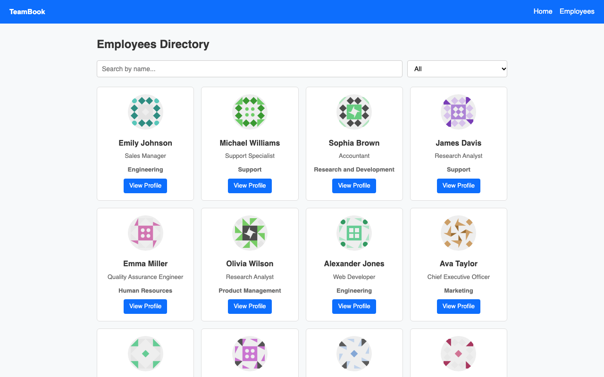
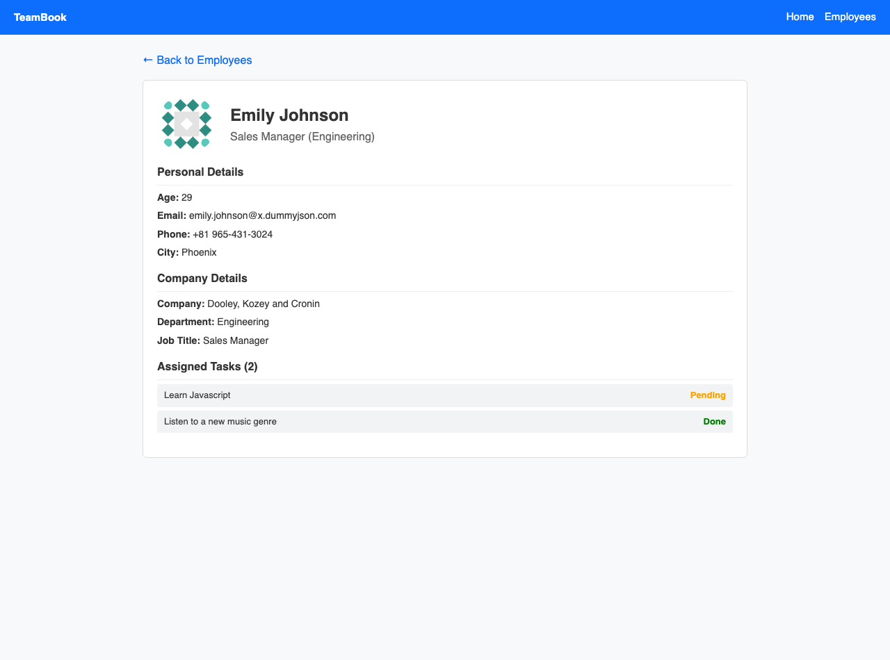

# PS7: TeamBook - An Employee Directory

A simple and responsive React web application built for HR and managers to explore company employees, view detailed profiles, and track assigned tasks.

## Project Details
- **Problem Statement Number**: PS7
- **Project Name**: TeamBook
- **Live Link**: [https://ps7-teambook-sigma.vercel.app/](https://ps7-teambook-sigma.vercel.app/)

---

## APIs Used
1. **Employees Directory API**: `https://dummyjson.com/users?limit=30` (Fetches 30 employee records)
2. **Employee Profile API**: `https://dummyjson.com/users/:id` (Fetches individual employee details using `useParams`)
3. **Employee Tasks (Bonus) API**: `https://dummyjson.com/users/:id/todos` (Fetches tasks assigned to the employee)

---

## List of Routes
| Route | Page Description | API Used |
| :--- | :--- | :--- |
| `/` | **Home Page**: Hero section with welcoming information and a "View team" button. | None |
| `/employees` | **Employees Directory**: Cards displaying photo, full name, job title, department; with live search by name and department filter dropdown. | `https://dummyjson.com/users?limit=30` |
| `/employees/:id` | **Employee Profile**: Shows photo, name, age, email, phone, city, company name, department, job title, and assigned tasks marked as Done / Pending. *(Strictly excludes password, ssn, and bank fields)* | `https://dummyjson.com/users/:id`<br>`https://dummyjson.com/users/:id/todos` |
| `*` | **404 Page**: "Page not found" message with a button to return to Home. | None |

---

## Screenshots

### 1. Employees Directory (`/employees`)


### 2. Employee Profile & Assigned Tasks (`/employees/:id`)


---

## React Concepts Covered
- **`useState`**: Used for managing search input, department dropdown filter, employees list, loading state, and error handling.
- **`useEffect`**: Used for fetching employee data on component mount and loading single user details when route parameters change.
- **`props`**: Reusable component `<EmployeeCard employee={emp} />` receives and displays employee data via props.
- **`react-router-dom`**: Handled routing using `BrowserRouter`, `Routes`, `Route`, `Link`, and `useParams`.

---

## How to Run Locally

1. Clone the repository:
```bash
git clone https://github.com/<your-username>/ps7-teambook.git
cd ps7-teambook
```

2. Install dependencies:
```bash
npm install
```

3. Run the development server:
```bash
npm run dev
```

4. Open `http://localhost:5173/` in your browser.
